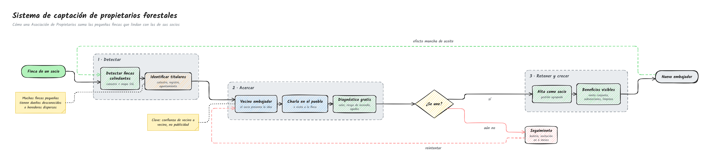
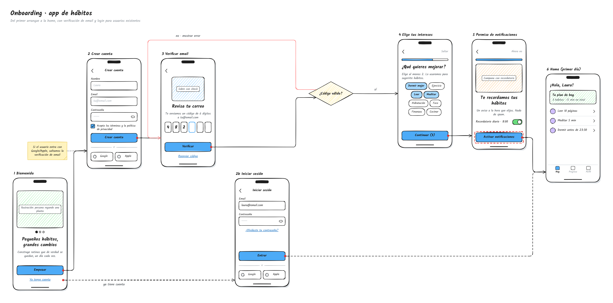
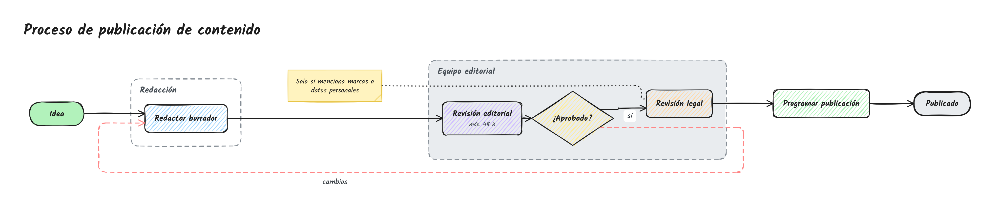
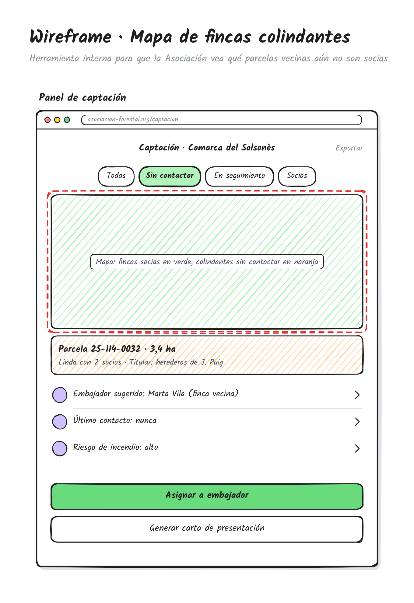

# Hand-drawn diagrams · Skill para Claude

Una skill para Claude que dibuja **diagramas de flujo, workflows, flujos de pantallas y wireframes con aspecto de pizarra hecho a mano**: trazos irregulares, rellenos rayados y letra manuscrita.

Le describes la idea a Claude y él escribe una especificación en JSON. La skill la convierte en un SVG y un PNG, y la maquetación es automática: nunca hay que calcular coordenadas.



## Ejemplos

### Proceso con bucles y fases
Un sistema para que una Asociación de Propietarios Forestales sume a los propietarios de las fincas colindantes. Usa grupos para las fases, una decisión y dos bucles: uno de reintento (en rojo) y otro de crecimiento (en verde).


→ [`forest-owners.json`](skills/hand-drawn-diagrams/examples/forest-owners.json)

> **Prompt:** *"Necesito un draft visual de una idea: un sistema para que las Asociaciones de Propietarios Forestales consigan más propietarios de pequeñas fincas aledañas"*

### Flujo de pantallas (onboarding)
Pantallas de móvil enlazadas desde sus botones, como en un prototipo. Incluye un rombo de decisión, un camino alternativo y una nota.


→ [`onboarding.json`](skills/hand-drawn-diagrams/examples/onboarding.json)

### Workflow con swimlanes
Un proceso editorial con un grupo por equipo y un bucle de "cambios".


→ [`workflow.json`](skills/hand-drawn-diagrams/examples/workflow.json)

### Wireframe de escritorio
Una sola pantalla con navegador, filtros, mapa destacado, ficha y botones de acción.



→ [`wireframe.json`](skills/hand-drawn-diagrams/examples/wireframe.json)

## Instalación

### Claude Code
Ejecuta estos dos comandos **por separado**, uno detrás de otro. Si los pegas juntos, Claude Code los toma como un solo comando y no instala nada.

1. Añade el marketplace:
   ```
   /plugin marketplace add pausanchez/hand-drawn-diagrams
   ```
2. Instala el plugin:
   ```
   /plugin install hand-drawn-diagrams@pausanchez
   ```

### Claude.ai / app de Claude
1. Descarga la carpeta [`skills/hand-drawn-diagrams`](skills/hand-drawn-diagrams) y comprímela en un `.zip`. Puedes usar *Code → Download ZIP* y quedarte solo con esa carpeta.
2. Ve a **Ajustes → Capacidades → Skills** y sube el zip.

### A mano
Copia `skills/hand-drawn-diagrams` en `~/.claude/skills/`.

**No hace falta instalar nada más.** Solo necesitas Node 18 o superior. Las dependencias van empaquetadas en la skill y el PNG se genera con WebAssembly, sin navegador, así que funciona igual en Mac, Windows y Linux.

## Uso

Pídeselo a Claude con naturalidad:

- *"Dibújame en estilo pizarra el flujo de alta de un cliente"*
- *"Haz un wireframe a mano de la pantalla de checkout"*
- *"Usa /hand-drawn-diagrams para el proceso de aprobación de facturas"*

También puedes renderizar una especificación directamente:

```bash
node skills/hand-drawn-diagrams/scripts/render.mjs mi-diagrama.json --out out/mi-diagrama
```

Toda la referencia del formato está en [`reference/spec-format.md`](skills/hand-drawn-diagrams/reference/spec-format.md). Los criterios de color y maquetación están en [`reference/style-guide.md`](skills/hand-drawn-diagrams/reference/style-guide.md).

## Qué puede dibujar

| Tipo | Elementos |
|---|---|
| Procesos y decisiones | cajas, rombos, inicio/fin, notas adhesivas |
| Swimlanes y fases | grupos con borde discontinuo, coloreables |
| Flujos de pantallas | móvil, tablet o escritorio con componentes (inputs, botones, chips, listas, tarjetas, OTP…) y flechas que salen de los botones |
| Wireframes | una sola pantalla con texto realista |

Estilo configurable: fuente (Kalam o Caveat), rugosidad, tipo de relleno, color de acento y semilla.

## Desarrollo

El código fuente del renderizador está en `skills/hand-drawn-diagrams/src/render.mjs`. `scripts/render.mjs` es un bundle generado a partir de él: no lo edites a mano.

```bash
cd skills/hand-drawn-diagrams
npm install          # solo para desarrollar: esbuild, roughjs, elkjs, opentype.js, resvg-wasm
npm run build        # regenera scripts/render.mjs y scripts/resvg.wasm
npm run examples     # renderiza los 4 ejemplos en out/
```

En cada push y cada PR, la CI valida el plugin, comprueba que el bundle está al día y renderiza los ejemplos desde una copia limpia, sin `node_modules`. Antes de publicar una versión, súbela en `.claude-plugin/plugin.json` y `marketplace.json`: así les llega la actualización a quienes ya tienen el plugin instalado.

## Créditos

Creada por [Pau Sánchez](https://github.com/pausanchez) con la ayuda de Claude.
Usa [rough.js](https://roughjs.com), [ELK.js](https://github.com/kieler/elkjs), [opentype.js](https://opentype.js.org) y [resvg](https://github.com/linebender/resvg), y las fuentes Kalam y Caveat (SIL OFL 1.1).

## Licencia

[MIT](LICENSE): úsala, modifícala y compártela libremente.
